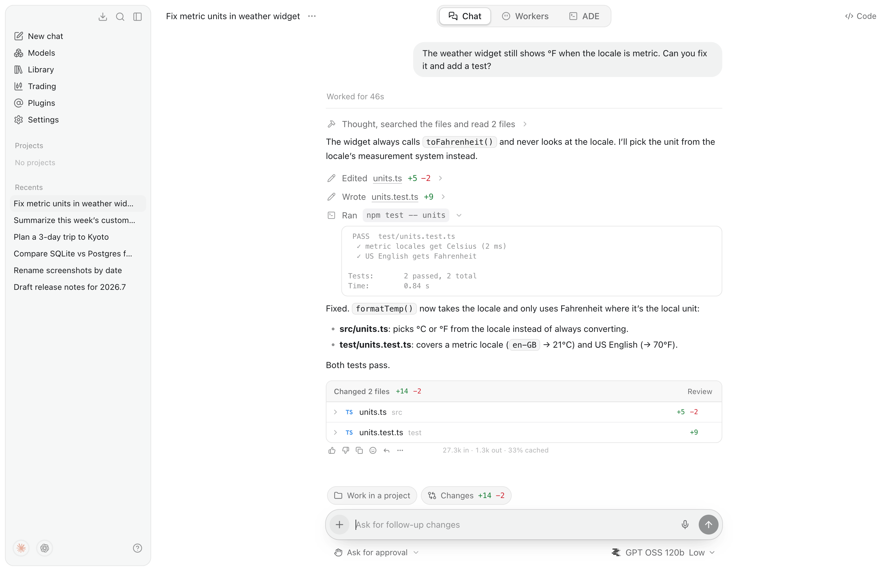
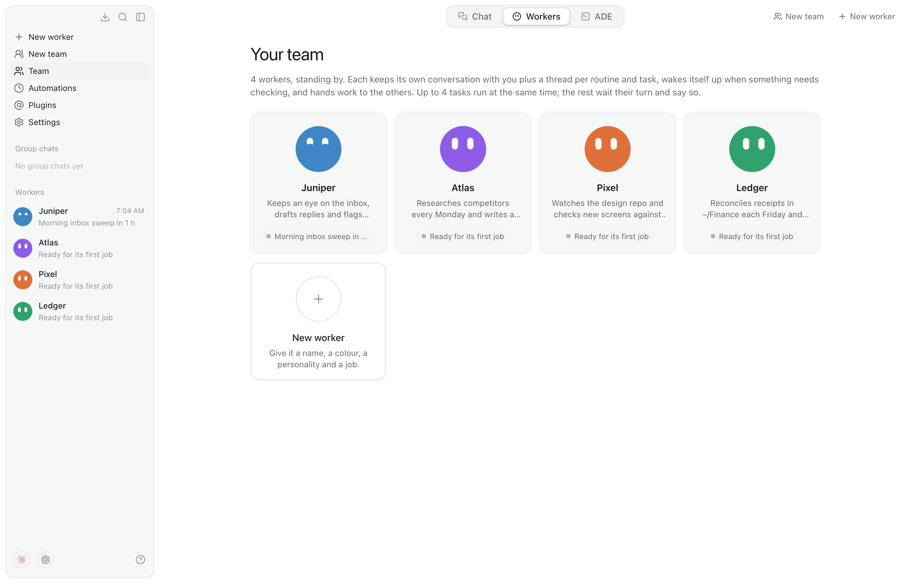
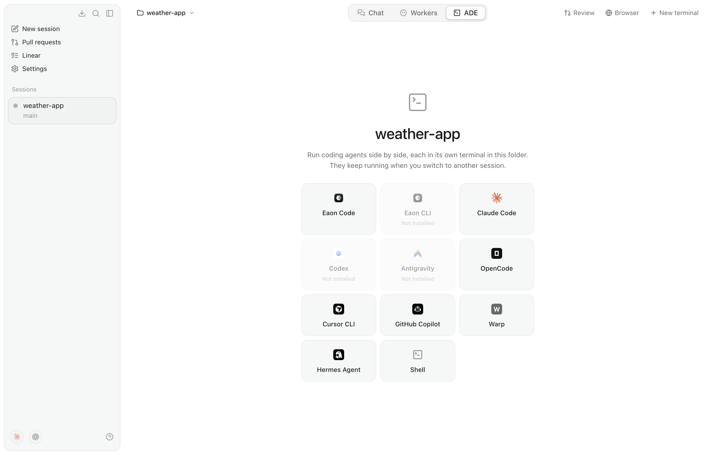
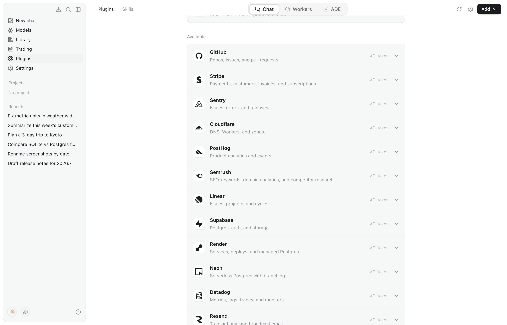
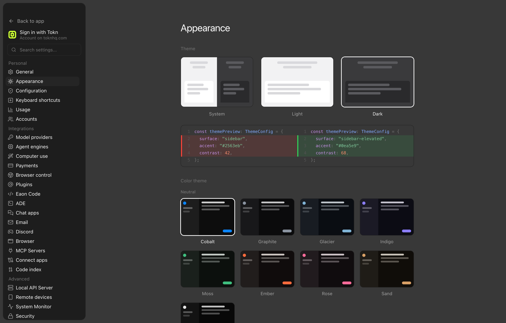

<p align="center">
  <picture>
    <source media="(prefers-color-scheme: dark)" srcset="resources/brand/eaon-lockup-on-dark.svg">
    
  </picture>
</p>

<p align="center">
  <b>An AI desktop app that runs on your own keys.</b><br>
  Chat with any model, let always-on Workers take jobs off your plate, and run every coding agent side by side in one place.
</p>

<p align="center">
  <a href="https://github.com/eaonlabs/eaon-desktop/releases"></a>
  
  <a href="LICENSE.md"></a>
</p>

<p align="center">
  <picture>
    <source media="(prefers-color-scheme: dark)" srcset="docs/images/chat-dark.png">
    
  </picture>
</p>

## Contents

- [What's inside](#whats-inside)
- [Install](#install)
- [Connect a model](#connect-a-model)
- [Eaon CLI](#eaon-cli-beta)
- [Computer and browser control](#computer-and-browser-control)
- [Privacy and security](#privacy-and-security)
- [Develop](#develop)

## What's inside

Eaon has three tabs, always at the top of the window (<kbd>⌘1</kbd> <kbd>⌘2</kbd> <kbd>⌘3</kbd>).

### Chat

An assistant that answers plainly, with an agent underneath for when you want
something done. It works with files and commands in its folder (`~/Eaon`
unless you pick a project), the web, connected plugins, your own browser and
your computer. Each turn shows its steps as it goes: what it read, the diff of
every edit, the commands it ran and their output, and a review of every file
it changed.

- **Plan, Swarm and Goal modes.** Plan proposes before it acts, Swarm splits a
  job across sub-agents, and Goal keeps working until the objective is met or
  a deadline passes.
- **You decide what needs approval.** Changes ask first unless you pick
  Auto-approve, and risky actions always ask. Approvals dock above the message
  box so a run never waits unseen.
- **A Code panel** opens the agent's folder next to the conversation, with a
  file tree, tabs and an editor.
- **Library** keeps every file you've attached to a chat.

### Workers

<picture>
  <source media="(prefers-color-scheme: dark)" srcset="docs/images/workers-dark.png">
  
</picture>

Always-on agents, each with a name, colour, personality and purpose.

- Every worker keeps its own conversation with you, plus a thread for each
  routine, side task and job a colleague hands it.
- **Routines and wake-ups.** Workers run on a schedule, wake themselves when a
  page, file or process changes, and can work toward a goal for hours with an
  end time.
- **Teamwork.** Workers message each other, hand over files, share out big
  jobs and post in group chats.
- **Teach** a worker by doing the task once in its browser. It saves the steps
  as a playbook.
- **Purchase schedules.** Type `/purchase` in a worker's conversation to set up
  an order, once or on repeat, for one store up to a set amount. Autopilot
  takes it from cart to confirmation with no questions.
- Every run leaves a receipt with how it went, and Retry. Nobody is watching
  to approve risky actions, so workers refuse them or ask you.

Workers run on Eaon's own agent with any model, or on an installed Codex.

### ADE

<picture>
  <source media="(prefers-color-scheme: dark)" srcset="docs/images/ade-dark.png">
  
</picture>

The agentic development environment. Open a project folder and run coding
agents side by side, each in a real terminal: Eaon Code, Claude Code, Codex,
Gemini CLI, Cursor CLI, GitHub Copilot, OpenCode, Amp and more than a dozen
others, or a plain shell.

- **Sessions on their own branches.** New session makes a git worktree, so
  agents don't trip over each other.
- **Hand off** a stuck task to a different agent. Eaon writes what was asked,
  said and done so far into the project, and the new agent starts from there.
- **Review, commit and open pull requests** from the ADE, with checks and merge
  conflicts handled in place. Pull requests and Linear issues have pages of
  their own.
- Claude Code panes start with `--dangerously-skip-permissions`, so the ADE
  doesn't stop at every prompt.

### And also

<table>
  <tr>
    <td width="50%" valign="top">
      <picture>
        <source media="(prefers-color-scheme: dark)" srcset="docs/images/plugins-dark.png">
        
      </picture>
      <p><b>72 plugins</b> with browser sign-in or an API token, plus MCP servers and skills (<code>SKILL.md</code>).</p>
    </td>
    <td width="50%" valign="top">
      
      <p><b>Themes</b> from four values (accent, background, foreground, contrast), colour presets, see-through windows and Glass terminals.</p>
    </td>
  </tr>
</table>

- **Automations**: scheduled tasks with cron schedules that run in the
  background, even with the window closed.
- **Usage**: tokens and spend across Eaon, Claude Code, Codex and other coding
  CLIs, with plan limits shown as rings or a bar.
- **Voice**: dictation and read-aloud, with a choice of speech-to-text model.
- **Eaon Remote**: use your terminals and Workers from another device, watch
  the agents' browsers live, and share a terminal with a link that expires.
- **Local models**: a curated model library, plus Ollama, LM Studio,
  llama.cpp, MLX, vLLM and Jan, found automatically.
- **Chat apps and email**: talk to Eaon and your Workers from Discord, Telegram
  or WhatsApp, and let them read and answer email.
- **Enterprise controls**: a managed policy (MDM or GPO) and an audit log. See
  [docs/enterprise.md](docs/enterprise.md).

## Install

Download the latest build from [Releases](https://github.com/eaonlabs/eaon-desktop/releases).
Eaon updates itself once installed.

| Platform | Download | Notes |
| --- | --- | --- |
| **macOS** 12+ | `Eaon-<version>.dmg` | Open it and drag Eaon to Applications. Signed and notarized. |
| **Windows** 10+ (x64, arm64) | `Eaon-<version>-setup.exe` | Installs for your user, with no administrator prompt. |
| **Linux** (x64, arm64) | `.deb` or `.AppImage` | Ubuntu 22.04+, Debian 12 and Fedora. |

<details>
<summary>Platform notes</summary>

- **Windows:** SmartScreen may say "Windows protected your PC" until the
  installer is signed; choose More info, then Run anyway. Local models need
  Microsoft's [Visual C++ Redistributable](https://aka.ms/vs/17/release/vc_redist.x64.exe)
  ([arm64](https://aka.ms/vs/17/release/vc_redist.arm64.exe)), which most PCs
  already have.
- **Linux:** install the .deb with
  `sudo apt install ./eaon-desktop_<version>_<arch>.deb`, or run the AppImage
  with `chmod +x Eaon-<version>-<arch>.AppImage && ./Eaon-<version>-<arch>.AppImage`.
  The .deb also installs an AppArmor profile, which Ubuntu 23.10 and later need
  before Chromium's sandbox will start.

</details>

## Connect a model

Open **Settings → Model providers** and paste a key, sign in with a supported
account, or pick a local model. Around 40 providers come set up:

| Kind | Providers |
| --- | --- |
| Frontier labs | Anthropic, OpenAI, Google Gemini, xAI, Mistral, DeepSeek, Kimi, Z.ai, Cohere, Perplexity |
| Gateways | OpenRouter, Vercel AI Gateway, Hugging Face, Azure OpenAI, Poe |
| Fast inference | Groq, Cerebras, Fireworks, Together AI, DeepInfra, NVIDIA NIM and more |
| Subscriptions | GLM Coding Plan, OpenCode Go and others |
| Local | Ollama, LM Studio, llama.cpp, MLX, vLLM, Jan; no key needed |
| Custom | Anything that speaks the OpenAI chat-completions format |

After you save a key, Eaon lists the provider's models straight away. Model
lists come from a catalog built from Pi's provider data and
[models.dev](https://models.dev) (`npm run generate:models`), refreshed daily
while the app runs and merged with each provider's own `/models`. The
composer's **Effort** control offers exactly the reasoning levels the chosen
model supports.

## Eaon CLI (beta)

`cli/` is Eaon in a terminal: Chat and Workers as in the app, with an agentic
trading desk in place of the ADE. It runs this app's main process headless,
can import your setup from the desktop app, and talks to other terminal
sessions, including Claude Code and Codex.

```bash
npm install -g eaon-cli
eaon
```

It updates itself. From a checkout, `npm run build:cli`, then `npm link` and
run `eaon`. See [cli/README.md](cli/README.md).

## Computer and browser control

Eaon builds on two open-source engines:

- **Computer use** runs on [Cua Driver](https://github.com/trycua/cua) (MIT),
  which works with apps through their accessibility tree. It ships inside Eaon,
  pinned and checksummed by `scripts/fetch-cua-driver.mjs`, and runs as Eaon's
  own child process so it uses Eaon's macOS permissions. Without it, Eaon falls
  back to its own engine.
- **Browser control** runs on [Browser Use](https://github.com/browser-use/browser-use)
  (MIT), attached to your own Chromium browser through its remote debugging
  switch, with no extension. **Settings → Browser control** installs it, with
  its own Python, into Eaon's data folder using [uv](https://github.com/astral-sh/uv).

Both run with their telemetry off.

## Privacy and security

- **Keys stay on your computer.** They're encrypted with the OS keychain
  (Electron `safeStorage`), never sent to the renderer process, and only ever
  sent to the provider you entered them for.
- The window runs sandboxed, app data is readable only by your user account,
  and developer tools are off in installed builds.
- Usage from other coding tools is read from their logs on your computer and
  never uploaded.

To report a vulnerability, see [SECURITY.md](SECURITY.md).

## Develop

Eaon is built with Electron, React and TypeScript (electron-vite).

```bash
npm install
npm run dev          # hot-reloading dev build
npm run build        # production bundle into out/
npm start            # run the production bundle
npm run dist:mac     # package a .dmg and .zip
npm run dist:win     # package the Windows installer (x64 + arm64)
npm run dist:linux   # package an AppImage and a .deb (on Linux)
```

### Tests

```bash
npm run typecheck
npm run test:main                                         # main-process tests (esbuild + node --test)
npm run test:e2e                                          # end-to-end: the built app, driven over DevTools
EAON_TEST_OUT=test-quick npm run test:main                # a quick run beside a live one
EAON_LIVE=1 npm run test:main -- agent-live               # real agent runs against local Ollama (EAON_LIVE_MODEL)
EAON_BROWSER_USE_LIVE=1 npm run test:main -- browser-use  # Browser Use installed for real, driving a throwaway Chrome
npm run verify:plugins                                    # checks every catalog plugin live
npm run verify:models                                     # checks every library model resolves
```

The end-to-end suite gives each run its own profile and home folder, a mock
keychain and a fake model server, so it never touches your real data or spends
on an API.

### Source layout

```
src/main       main process: windows, store, key vault, agents, Workers, ADE terminals
src/preload    contextBridge API exposed to the renderer as window.api
src/renderer   React UI (components, state, styles, icons)
src/shared     types shared across processes
cli/           Eaon CLI
test/          main-process tests; test/e2e for end-to-end
docs/          enterprise deployment, remote API, screenshots
```

### Screenshot harness

`EAON_CAPTURE=<dir> npx electron ./out/main/index.js` drives the UI offscreen
and writes a PNG per screen. Point `EAON_CAPTURE_STEPS` at a JSON file of
`[{ "name", "script" }]` steps to capture your own. It resets the store first,
so give it its own `--user-data-dir`. It does nothing without the env var.

## License

[GPL-3.0](LICENSE.md). Third-party notices are in [NOTICE](NOTICE).
